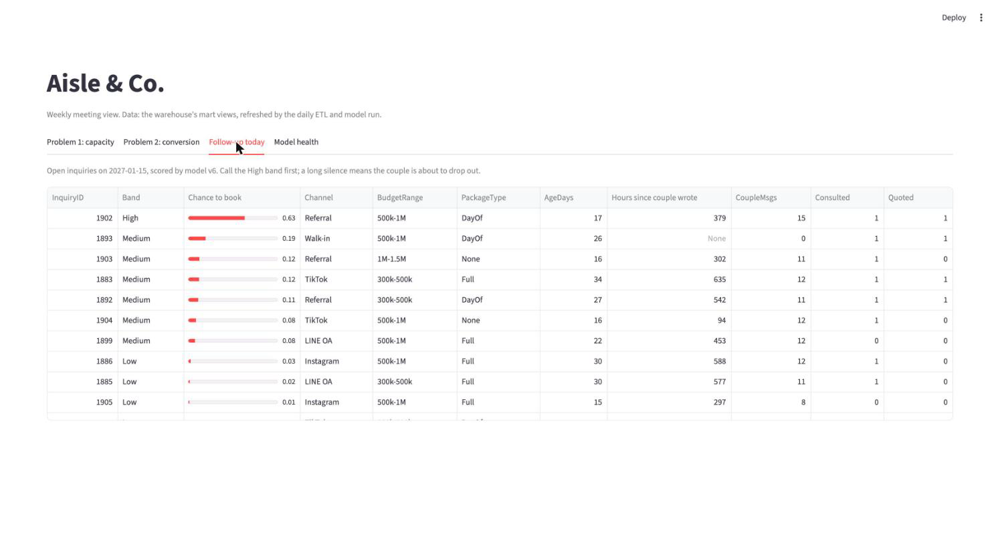

# Aisle & Co. data pipeline and conversion model (MADT 8102 capstone, Chapters 6 and 7)

ETL demo (Chapter 6): 

Conversion model and MLOps (Chapter 7): 

ETL pipeline from the wedding organizer's CRM (PostgreSQL, OLTP v5) to its data warehouse (DW v7), built for
two business problems: seasonal demand and capacity (Problem 1) and high inquiry, low conversion (Problem 2).
On top of the warehouse: a feature store in PostgreSQL, a conversion model that scores every open inquiry each
morning (with a validation gate, a model registry, drift monitoring and weekly retraining, all run by Airflow), and
a Streamlit dashboard. All data in this repository is synthetic: fictional couples and three simulated business years.

## Run it in Google Colab

Open a badge above and choose **Runtime → Run all**. The first two cells clone this repository and install
PostgreSQL 16 inside the Colab session. The ML notebook takes about 4 minutes. The ETL notebook takes about 7
minutes on a standard Colab machine (about 2 for the setup, about 3 for the automated tests). The ETL notebook
shows the architecture and schema, both business problems followed run by run, data-quality and error
handling, recovery, the source-to-target check, performance and the batch-cap queue, and all automated tests.

## What is here

| Path | Contents |
|---|---|
| `AisleCo_ETL_Pipeline_Demo_Colab.ipynb` | The demo for Colab (no saved outputs; run it) |
| `AisleCo_ETL_Pipeline_Demo.ipynb` | The same demo for a local run, with its outputs saved |
| `AisleCo_ML_Conversion_Demo.ipynb` (+ `_Colab`) | Chapter 7: feature store, training and gate, registry, scoring, drift and retraining |
| `ml/` | Conversion model: features, training, scoring, monitoring (`python -m ml`) |
| `dashboard/` | Streamlit dashboard (`streamlit run dashboard/app.py`) |
| `etl/` | The pipeline: extract, stage, data quality, load, runner, command line |
| `sql/` | Schemas (OLTP v5, DW v7), transformations, KPI views |
| `tests/` | 38 pytest tests |
| `scripts/` | Walkthrough loader, simulated-data loader, cross-check, benchmark and stress test, notebook builder |
| `airflow/dags/` | The same steps as Airflow DAGs: daily ETL + scoring, weekly training |
| `docs/` | Section 6 (ETL design), Section 7 (model and MLOps), diagrams, stress-test results, dashboard screenshots |
| `data/sim/zones_v3/` | Three simulated business years, used by the source-to-target check and the model |

`README_current_files.md` describes every file and the local setup (macOS, PostgreSQL 16, Airflow).

